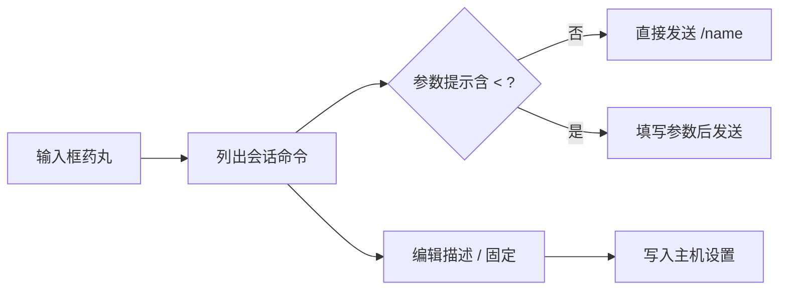

# 斜杠命令面板

在输入框旁边放一个命令面板，直接浏览、搜索并调用当前 agent 会话提供的斜杠命令和 skill，同时可以把 provider 给出的英文描述替换成自己的中文描述。

## 功能

- **每个活跃 agent 一个输入框药丸**：插件启动时按 `scope: "active"` 分页拉取 agent 列表（每页 200 条），并订阅 agent 变更事件；有 workspace 且未归档的 agent 才会得到一个药丸，agent 被归档、被移除或换 workspace 时对应药丸会自动撤销。药丸标题为「斜杠命令」，标签为「命令」，图标为 `Command`。
- **命令列表来自会话本身**：点开药丸时通过 `paseo.agents.ref(agentId).commands()` 向该 agent 的实时会话查询命令，不缓存插件自己的命令清单。每行显示命令名（`/name`）、参数提示（`argumentHint`）、描述；`kind` 为 `skill` 的行会额外显示 `skill` 标签。查询结果在 30 秒内视为新鲜，失败不重试，错误直接显示在面板里。
- **过滤**：顶部输入框按命令名或当前显示的描述（自定义描述优先）做不区分大小写的子串匹配；无匹配和无命令时分别给出不同提示。
- **发送即 prompt**：在没有必填参数时点击命令立即以 `paseo.agents.ref(agentId).send("/name 参数")` 发送并关闭面板，等价于在输入框里手打 `/name`，由 provider 自己解释该命令。参数提示里含 `<` 的命令会先进入参数填写步骤，也可以在任何带参数提示的命令上点「参数」手动进入该步骤。
- **描述本地化**：每行右侧铅笔图标可以单独编辑该命令的描述，保存后写入插件设置；面板里自定义描述用高亮色显示，与 provider 原文区分。设置页「命令描述」提供批量编辑：每行 `命令名=描述`（命令名可带或不带开头的 `/`），`#` 开头的行会被忽略，留空表示恢复 provider 原文，页面显示已填条数，支持保存、放弃修改、全部清除。
- **固定常用命令**：每行右侧图钉可固定/取消固定，固定项排在最前（中间用分隔线隔开），但两组内部都保持 provider 返回的原始顺序。

## 安装

从 GitHub 安装：

```bash
paseo plugin install git:ElderDoge/paseo-plugins:paseo-slash-palette
```

在本仓库目录内以开发模式安装：

```bash
paseo plugin install "$PWD"
paseo plugin reload paseo-slash-palette
```

## 依赖与前置条件

- Paseo `>=0.8.0`（见 `paseo-plugin.json` 的 `requirements.paseo`）。插件依赖该版本提供的 `addComposerPill`、`addSettingsScreen`、`agents.list` / `agents.subscribe` 与 `agents.ref(id).commands()` 等客户端接口。
- 需要目标 agent 会话自身提供斜杠命令。命令来自 provider 会话，插件不内置命令表；会话没有命令时面板会显示「当前会话没有提供斜杠命令。」。
- 无需额外的 CLI、账号或密钥，插件不读写外部文件，也没有自己的配置文件。

## 用法

1. 安装并 reload 插件后，打开一个已经运行 agent 的会话，输入框旁边会出现「命令」药丸。
2. 点开药丸即可看到该会话的斜杠命令和 skill 列表；在顶部输入框里输入关键字可过滤。
3. 点击某一行直接发送该命令；带必填参数（参数提示含 `<`）的命令会先弹出参数输入步骤，填写后点「发送」或直接回车。
4. 想改描述：点行右侧的铅笔图标单独修改，或进入插件设置页「命令描述」批量修改。设置页只有在存储内容无法解析时才会显示「重置存储」按钮，可整体恢复默认值。
5. 想固定常用命令：点行右侧图钉图标；固定与描述修改都会立即写入设置，写入期间其余操作会被暂时禁用。



## 文件结构

| 路径 | 层级 | 职责 |
| --- | --- | --- |
| `index.client.tsx` | App 侧入口 | 维护每个活跃 agent 的输入框药丸（`addComposerPill`）、注册设置页（`addSettingsScreen`）、订阅并追踪 agent 列表 |
| `index.server.ts` | 守护进程侧入口 | 仅调用 `server.registerSettings(commandDescriptions)` 注册插件设置文档 |
| `client/palette.tsx` | App 侧 UI | 命令面板本体：查询会话命令、过滤、发送、填写参数、编辑描述与固定；导出药丸图标 |
| `client/settings-screen.tsx` | App 侧 UI | 「命令描述」设置页：批量文本编辑 `命令名=描述`、保存/放弃/清空、异常时重置存储 |
| `shared/descriptions.ts` | 共享 | 用 `defineSettings` 定义设置文档 `command-descriptions`（`scope: "host"`，`version: 1`，zod schema：`descriptions` 记录与 `pinned` 数组），客户端与守护进程共用 |
| `paseo-plugin.json` | 清单 | 插件 id、名称、描述与 `requirements.paseo` 版本下限 |
| `package.json` | 清单 | 包元数据与 `typecheck` 脚本；依赖全部为 devDependencies |
| `tsconfig.json` | 配置 | TypeScript 编译配置，仅用于类型检查 |

设置数据存放在 Paseo 主机的插件设置存储中（`scope: "host"`，由守护进程侧 `registerSettings` 注册），以命令名为键，而不是写在本插件目录里的文件。因此描述与固定项对该主机上的所有会话生效。

## 已知限制

- 命令清单完全来自 provider 会话，插件无法调用会话未报告的命令；`commands()` 返回的 `error` 字段会原样显示在面板里。
- 是否「需要参数」只看 `argumentHint` 是否包含 `<`，这是启发式判断：参数提示里没有 `<>` 的命令会被直接发送。
- 自定义描述以命令名为键，同名命令（不同来源）会共用同一条描述；描述与固定项都按主机全局生效，不区分 workspace 或 agent。
- 固定项按固定顺序存储，但渲染时固定组与其余命令都按 provider 返回的顺序排列，因此调整固定顺序不会改变显示顺序。
- 每次设置写入或发送只能有一个在进行（`busy` 会禁用其余操作），写入基于 revision，过期写入会被拒绝并提示重试。
- 面板自身不提供滚动容器与高度，滚动交给宿主表面（移动端 BottomSheet 的滚动视图、桌面端 popover 的 FloatingScrollView）。
- 参数/描述的表单在非 Web 且非紧凑布局（平板、桌面窗口）下放进宿主的 `Modal`，其余情况在面板内以页内页形式展示。
